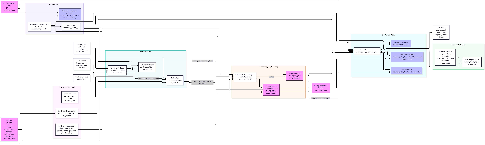

# Release v0.2.0

**Date:** 2026-11-18
**Milestone:** [Release v0.2.0](https://github.com/kate8382/AURA/milestone/1)

## Summary

v0.2.0 delivers the core trial engine, fail-closed shape validation, metadata stabilization, the `real_cases` dataset framework, the `benign_cases` pipeline, and community cross-check adapters (`bounty-scope` and `pgp-verify`) backed by automated CI policy enforcement.

Architecture after this release: [aura-pipeline-v4](../diagrams/aura-pipeline-v4.mmd) (PNG: `docs/diagrams/aura-pipeline-v4.png`).

## Key Features & Epics

### 1. Community Adapters for Cross-Check Enforcement (Epic [#28](https://github.com/kate8382/AURA/issues/28))

- **`adapter:bounty-scope` ([#87](https://github.com/kate8382/AURA/issues/87)):** Offline, snapshot-based verification of bug bounty program metadata (HackerOne, Bugcrowd) using local snapshots (`config/snapshots/bounty-programs.json`). Implemented in [#90](https://github.com/kate8382/AURA/pull/90).
- **`adapter:pgp-verify` ([#88](https://github.com/kate8382/AURA/issues/88)):** Cryptographic PGP signature verification against a static local allowlist (`scripts/policy/pgp/`, openpgp 6.3.2). Implemented in [#117](https://github.com/kate8382/AURA/pull/117).
- **Policy-as-Code Validation ([#89](https://github.com/kate8382/AURA/issues/89)):** CI gate (`npm run validate:keys`) that checks manifest/directory synchronization, ASCII-armor format, fingerprint integrity, a 2-year maximum validity window, RSA ≥ 3072 bits, approved elliptic curves (Ed25519, NIST P-256/P-384/P-521), and rejects SHA-1 and MD5 signatures. Implemented in [#141](https://github.com/kate8382/AURA/pull/141).

### 2. Real Cases Dataset & Pipeline (Epic [#84](https://github.com/kate8382/AURA/issues/84))

- Source/license audit, data-handling policy, and provenance fields per case ([#78](https://github.com/kate8382/AURA/issues/78), [#79](https://github.com/kate8382/AURA/issues/79)).
- Unified directory targeting (`--dir`/`CASES_DIR`) with `real_cases` validation in CI ([#80](https://github.com/kate8382/AURA/issues/80)).
- Licensing split and third-party attribution in `NOTICE` ([#81](https://github.com/kate8382/AURA/issues/81)).
- Pilot: 15 real prompts analyzed end to end, case ID scheme, and trigger cleanup ([#82](https://github.com/kate8382/AURA/issues/82)).
- Documentation: README, contributor guide, and differences from `synthetic_cases` ([#83](https://github.com/kate8382/AURA/issues/83)).

### 3. Engine Robustness & Performance

- **Async Bulk I/O & Caching ([#37](https://github.com/kate8382/AURA/issues/37)):** Resource caching and bounded concurrency for large dataset evaluations.
- **Strict Schema & Validation ([#35](https://github.com/kate8382/AURA/issues/35), [#38](https://github.com/kate8382/AURA/issues/38), [#39](https://github.com/kate8382/AURA/issues/39)):** Tightened per-case schema with AJV validation, overlap detection for trigger/signal configs, and CI failure on unexpected silent errors.
- **Race fix ([#34](https://github.com/kate8382/AURA/issues/34)):** `updateCase()` calls are awaited, so persisted confidence is no longer stale.
- **Recalc regression coverage ([#36](https://github.com/kate8382/AURA/issues/36)):** Integration and regression tests for the recalc pipeline.
- **Metadata & Vocabulary Stability ([#68](https://github.com/kate8382/AURA/issues/68), [#69](https://github.com/kate8382/AURA/issues/69), [#70](https://github.com/kate8382/AURA/issues/70)):** Versioned decision vocabulary and signal-catalog hash, action-type binding for egress checks, and declared-shape metadata with False Positive Rate (FPR) evaluation. Trial engine FPR integration: [#104](https://github.com/kate8382/AURA/pull/104).
- **Dataset Separation ([#106](https://github.com/kate8382/AURA/issues/106), [#139](https://github.com/kate8382/AURA/pull/139)):** Renamed `public_cases` to `synthetic_cases` and introduced the `benign_cases` pipeline (safe and clarify cases).

## Pull Requests Without a Linked Issue

- [#1](https://github.com/kate8382/AURA/pull/1) Compact signal IDs, structured categories, migration tools, docs and infra updates.
- [#11](https://github.com/kate8382/AURA/pull/11) Decision vs. confidence: policy mapping and schema.
- [#18](https://github.com/kate8382/AURA/pull/18) Confidence normalization, trigger weight retuning, removal of legacy fields, pipeline diagram.
- [#22](https://github.com/kate8382/AURA/pull/22) Policy evaluator fixes: veto, evasion, pending, thresholds.
- [#27](https://github.com/kate8382/AURA/pull/27) Machine-readable cross-check requirements and enforcement adapter.
- [#30](https://github.com/kate8382/AURA/pull/30) and [#33](https://github.com/kate8382/AURA/pull/33) Rule-based trigger extraction and its hardening.
- [#55](https://github.com/kate8382/AURA/pull/55) Tiered TF-IDF trigger weighting.
- [#58](https://github.com/kate8382/AURA/pull/58) License changed to BSL-1.1 (dual with Apache on the change date).
- [#65](https://github.com/kate8382/AURA/pull/65) `examples/` CLI demo and sample case.
- [#73](https://github.com/kate8382/AURA/pull/73) and [#119](https://github.com/kate8382/AURA/pull/119) Trigger-weight regeneration.
- [#74](https://github.com/kate8382/AURA/pull/74) Reduced duplicate traffic workflow runs.
- Automated traffic report and history updates (`Update traffic ...` workflow commits).

## Known Limitations

- **RSA key size in the PGP validator:** the policy minimum is RSA ≥ 3072 bits. openpgp.js cannot generate keys below 2047 bits, so the weak-RSA test uses RSA-2048 (rejected by the loader). The original spec example used RSA-1024.
- **Trusted-key allowlist is empty** (`config/trusted-keys/manifest.json`, `keys: []`) by design until the first keys are approved.
- **npm audit** reports vulnerabilities in transitive dependencies. They are not addressed in this release.

## Upgrade Notes

- `package.json` version is updated to `0.2.0`.
- Run `npm run validate:keys` locally to verify PGP trust-store changes.
- References to `public_cases` should be updated to `synthetic_cases` in local custom scripts.
